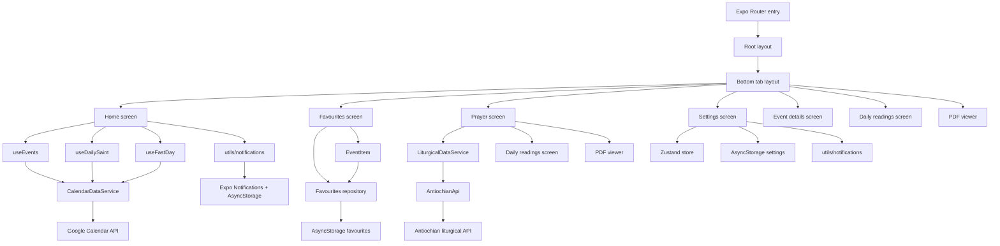

# Current architecture (observed)

This repository is not an AI/agent application. It is a cross-platform Expo/React Native app for St Paul’s parishioners. The codebase currently centers on screen components, custom hooks, a few utility modules, local persistence, and integrations with Google Calendar, the Antiochian liturgical API, Expo Notifications, and external URLs.

## 1. System overview

### What the app does today

The app currently provides:

- A home screen that lists parish events grouped by day.
- A favourites screen that stores selected events in local storage and shows them later.
- A prayer screen that fetches liturgical readings and service PDFs for a selected date.
- A settings screen for notification preferences and a small amount of application state.
- Screens for event details, daily reading text, and PDF viewing.
- Local notifications for “Saint of the Day” and some notification-related settings.

### Major components

- Expo Router screens under [app/](/Users/edes/Developer/work/SPAOC.worktrees/add-readme-file/app) and [app/(tabs)/](/Users/edes/Developer/work/SPAOC.worktrees/add-readme-file/app/(tabs))
- Custom data hooks under [hooks/](/Users/edes/Developer/work/SPAOC.worktrees/add-readme-file/hooks)
- API and external integration modules under [api/](/Users/edes/Developer/work/SPAOC.worktrees/add-readme-file/api) and [constants/consts.tsx](/Users/edes/Developer/work/SPAOC.worktrees/add-readme-file/constants/consts.tsx)
- Persistence and notification helpers under [utils/](/Users/edes/Developer/work/SPAOC.worktrees/add-readme-file/utils)
- Reusable UI under [components/](/Users/edes/Developer/work/SPAOC.worktrees/add-readme-file/components)

### External dependencies and services

The app integrates with:

- Google Calendar APIs for parish events, fasting dates, saints, and related calendars.
- The Antiochian liturgical API via [api/AntiochianApi.ts](/Users/edes/Developer/work/SPAOC.worktrees/add-readme-file/api/AntiochianApi.ts).
- Expo Notifications for scheduling local notifications.
- AsyncStorage for favourites and settings.
- Expo Router, React Navigation, and React Native UI libraries.

### Main execution flow

The runtime starts through Expo Router ([package.json](/Users/edes/Developer/work/SPAOC.worktrees/add-readme-file/package.json), [app/_layout.tsx](/Users/edes/Developer/work/SPAOC.worktrees/add-readme-file/app/_layout.tsx)). The tab layout mounts the main screens, which then load data from hooks and route navigation. The app uses a mix of direct component state, custom hooks, and module-level utilities rather than a single application state layer.

## 2. Architecture

The current architecture is a feature-oriented screen-based app with a fairly thin “UI shell” and business/data concerns spread across screens, hooks, and utilities.

### High-level structure

- Screen components own a large amount of UI behavior, layout, and state.
- Custom hooks act as data-fetching adapters for specific screens.
- Utilities contain notification scheduling, date grouping, and small helpers.
- Constants contain many hard-coded calendar IDs, API keys, and URLs.
- Persistence is handled directly by screens/hooks in AsyncStorage rather than through a distinct repository or storage layer.

### Mermaid diagram

### Notable architectural characteristics

- Screens are doing too much: data fetching, refresh logic, local state, navigation, styling, notifications, and sometimes modal state all live together.
- Hooks are not yet a consistent abstraction layer; they mostly fetch data directly and return state to a single screen.
- Persistence logic is repeated across multiple components rather than centralized.
- There is no provider-based or repository-based boundary separating UI from remote services.
- There is no AI/agent subsystem in this repository; there are no prompts, tool definitions, LLM providers, orchestration modules, memory stores, or model-selection layers.

## 3. Important flows

### 3.1 Home screen: event + saint + fast-day flow

Entry point:
- [app/(tabs)/index.tsx](/Users/edes/Developer/work/SPAOC.worktrees/add-readme-file/app/(tabs)/index.tsx)

Flow:
- On mount, the Home screen requests notification permissions, sets up notification listeners, and schedules Saint of the Day notifications.
- It calls three hooks:
  - [hooks/useEvents.tsx](/Users/edes/Developer/work/SPAOC.worktrees/add-readme-file/hooks/useEvents.tsx) to load parish events from every event calendar.
  - [hooks/useDailySaint.ts](/Users/edes/Developer/work/SPAOC.worktrees/add-readme-file/hooks/useDailySaint.ts) to load saints for the current date.
  - [hooks/useFastDay.ts](/Users/edes/Developer/work/SPAOC.worktrees/add-readme-file/hooks/useFastDay.ts) to load fasting calendar events and derive fast labels.
- All three hooks load data through `calendarService` from [services/calendar/](../services/calendar/index.ts), which implements the `CalendarDataService` interface. `useEvents` is kept as a compatibility wrapper so the screen is unchanged.
- The current implementation, `GoogleCalendarService`, holds the calendar IDs, request URLs, and error handling. [services/calendar/googleCalendarMapper.ts](../services/calendar/googleCalendarMapper.ts) normalizes Google events into the app's `EventData` shape. Nothing outside [services/calendar/](../services/calendar/index.ts) knows about Google Calendar.
- The data is grouped by date with [utils/dateUtils.ts](/Users/edes/Developer/work/SPAOC.worktrees/add-readme-file/utils/dateUtils.ts) and passed to a SectionList.
- Tapping an event navigates to [app/eventDetails.tsx](/Users/edes/Developer/work/SPAOC.worktrees/add-readme-file/app/eventDetails.tsx) with the event payload.

State and side effects:
- The screen uses local state for refresh status, date selection, month filtering, and the visible section list state.
- Side effects occur in the component itself (network requests, notifications, app-state refresh, navigation, haptics).

External calls:
- Google Calendar events endpoints, saints endpoint, fasting endpoint.
- Expo Notifications scheduling.

Decision points:
- The Home screen decides which fast label to display based on the current fasting events array.
- The screen also filters events by selected month using the grouped data it already loaded.

### 3.2 Event details flow

Entry point:
- [components/EventItem.tsx](/Users/edes/Developer/work/SPAOC.worktrees/add-readme-file/components/EventItem.tsx)

Flow:
- The event item pushes a route to `/eventDetails` with event params.
- [app/eventDetails.tsx](/Users/edes/Developer/work/SPAOC.worktrees/add-readme-file/app/eventDetails.tsx) reads params and renders the selected event.
- The screen can copy the location to the clipboard and open maps via `Linking`.

State and side effects:
- Mostly presentational, but it uses navigation options and side effects for clipboard and external links.

### 3.3 Favourites flow

Entry point:
- [components/EventItem.tsx](/Users/edes/Developer/work/SPAOC.worktrees/add-readme-file/components/EventItem.tsx) and [app/(tabs)/favourites.tsx](/Users/edes/Developer/work/SPAOC.worktrees/add-readme-file/app/(tabs)/favourites.tsx)

Flow:
- Tapping the star icon in the event item calls `addFavourite` or `removeFavourite` on the [favourites repository](../services/favourites/favouritesRepository.ts).
- The Favourites screen calls `removeExpiredFavourites` on focus, which drops expired events from storage and returns the upcoming ones.
- Favourite event notifications read the list with `getFavourites`.
- The screen renders favourite items using [components/EventItem.tsx](/Users/edes/Developer/work/SPAOC.worktrees/add-readme-file/components/EventItem.tsx).

State and side effects:
- Favourites are stored in AsyncStorage under the `favourites` key as a JSON object keyed by event ID/title.
- Only the repository reads or writes that key, so callers do not depend on the storage format.
- Expired favourites are removed from storage whenever the Favourites screen loads.

### 3.4 Settings and notification flow

Entry point:
- [app/settings.tsx](/Users/edes/Developer/work/SPAOC.worktrees/add-readme-file/app/settings.tsx)

Flow:
- The settings screen reads and writes settings to AsyncStorage.
- It uses a Zustand store for the start-of-week preference ([app/settings.tsx](/Users/edes/Developer/work/SPAOC.worktrees/add-readme-file/app/settings.tsx)).
- The settings screen interacts with [utils/notifications.ts](/Users/edes/Developer/work/SPAOC.worktrees/add-readme-file/utils/notifications.ts) to schedule or cancel local notifications.

State and side effects:
- Notification toggle state lives partly in React local state and partly in AsyncStorage.
- Notification scheduling is a side effect triggered from the UI layer.

### 3.5 Prayer / liturgical reading flow

Entry point:
- [app/(tabs)/prayer.tsx](/Users/edes/Developer/work/SPAOC.worktrees/add-readme-file/app/(tabs)/prayer.tsx)

Flow:
- The Prayer screen loads liturgical data through `liturgicalService` from [services/liturgical/](../services/liturgical/index.ts), which implements the `LiturgicalDataService` interface.
- The screen uses the service's helper methods to extract reading teasers, full reading text, and feast title.
- The current implementation, `AntiochianLiturgicalService`, wraps the client in [api/AntiochianApi.ts](../api/AntiochianApi.ts). Only the service layer imports that client.
- Selecting a date triggers a new fetch.
- Tapping a reading opens [app/dailyReadings.tsx](/Users/edes/Developer/work/SPAOC.worktrees/add-readme-file/app/dailyReadings.tsx).
- Tapping a service opens [app/pdfViewer.tsx](/Users/edes/Developer/work/SPAOC.worktrees/add-readme-file/app/pdfViewer.tsx).

State and side effects:
- The screen keeps loading, error, date, and organized-PDF state locally.
- The screen also triggers navigation to other routes.

### 3.6 AI / agent flow

There is no AI/LLM or agent orchestration flow in this repository.

Observed facts:
- No model provider integration is present.
- No prompt management, tool registry, agent definitions, memory store, or orchestration engine exists.
- The app contains no code paths that would route requests through an LLM or agent runtime.

## 4. Configuration

### Runtime configuration sources

The app uses the following configuration mechanisms:

- [app.json](/Users/edes/Developer/work/SPAOC.worktrees/add-readme-file/app.json) for Expo app metadata, bundle ID, orientation, scheme, and plugin configuration.
- [eas.json](/Users/edes/Developer/work/SPAOC.worktrees/add-readme-file/eas.json) for build profiles.
- [package.json](/Users/edes/Developer/work/SPAOC.worktrees/add-readme-file/package.json) for scripts, dependencies, and Expo/Jest configuration.
- [constants/consts.tsx](/Users/edes/Developer/work/SPAOC.worktrees/add-readme-file/constants/consts.tsx) for many hard-coded URLs, storage keys, and API-related values.
- [services/calendar/googleCalendarConfig.ts](../services/calendar/googleCalendarConfig.ts) for the Google Calendar IDs and API base URL.
- AsyncStorage keys defined in [constants/consts.tsx](/Users/edes/Developer/work/SPAOC.worktrees/add-readme-file/constants/consts.tsx).

### Environment variables and secrets

The repository currently does not use a conventional `.env` configuration layer. Instead, secrets and configuration are embedded in code:

- A Google API key is hard-coded in [constants/consts.tsx](/Users/edes/Developer/work/SPAOC.worktrees/add-readme-file/constants/consts.tsx).
- The Antiochian API client uses a hard-coded client ID and client secret in [api/AntiochianApi.ts](/Users/edes/Developer/work/SPAOC.worktrees/add-readme-file/api/AntiochianApi.ts).
- [assets/service_account.json](/Users/edes/Developer/work/SPAOC.worktrees/add-readme-file/assets/service_account.json) exists but is not wired into the runtime code visible here.

### Feature flags and runtime toggles

- The settings screen exposes a small number of user toggles for notifications and start-of-week behavior.
- Some UI sections are currently disabled through `false` conditions in [app/settings.tsx](/Users/edes/Developer/work/SPAOC.worktrees/add-readme-file/app/settings.tsx), suggesting partially completed or intentionally hidden functionality.
- [app/pdfViewer.tsx](/Users/edes/Developer/work/SPAOC.worktrees/add-readme-file/app/pdfViewer.tsx) has a hard-coded `USE_WEBVIEW` flag for a temporary PDF strategy.

## 5. Testing

### What is tested today

There is one visible Jest snapshot test:
- [components/__tests__/ThemedText-test.tsx](/Users/edes/Developer/work/SPAOC.worktrees/add-readme-file/components/__tests__/ThemedText-test.tsx)

Both data services have service-level tests that mock the network, not React hooks:
- [services/calendar/](../services/calendar/index.ts) tests inject or stub `fetch` and cover successful Google Calendar payloads, malformed and empty responses, and date normalization of timed and all-day events.
- [AntiochianLiturgicalService.network.test.ts](../services/liturgical/AntiochianLiturgicalService.network.test.ts) runs the service on the real Antiochian client with only axios mocked. It covers authentication, day ID derivation from dates, caching, malformed and empty responses, and reading/feast transformations.

Date tests build instants with explicit UTC offsets so they pass in any device time zone.

Favourites persistence has repository-level tests against the AsyncStorage Jest mock:
- [favouritesRepository.test.ts](../services/favourites/favouritesRepository.test.ts) covers loading data already stored in the existing format, add/remove, expiry at the end-time boundary, and invalid stored JSON.

### What is not tested

The current test coverage does not appear to cover:

- Navigation flows between screens.
- AsyncStorage persistence logic for settings.
- Notification scheduling and cancellation logic.
- How screens present remote failures and empty data to the user.
- UI-level transformation logic such as date grouping and fast-day derivation.

The test script in [package.json](/Users/edes/Developer/work/SPAOC.worktrees/add-readme-file/package.json) runs Jest in watch mode, which is not ideal for CI or regression safety.

## 6. Known architectural problems

The following are concrete issues visible in the codebase.

### 6.1 UI and data fetching are tightly coupled

Relevant files:
- [app/(tabs)/index.tsx](/Users/edes/Developer/work/SPAOC.worktrees/add-readme-file/app/(tabs)/index.tsx)
- [app/(tabs)/prayer.tsx](/Users/edes/Developer/work/SPAOC.worktrees/add-readme-file/app/(tabs)/prayer.tsx)
- [app/settings.tsx](/Users/edes/Developer/work/SPAOC.worktrees/add-readme-file/app/settings.tsx)

Evidence:
- The screen components orchestrate data loading, state changes, navigation, and side effects directly.
- Home and Prayer screens mix presentation, data loading, refresh logic, and external side effects in the same component.

### 6.2 Persistence logic is duplicated and scattered

Relevant files:
- [app/settings.tsx](/Users/edes/Developer/work/SPAOC.worktrees/add-readme-file/app/settings.tsx)
- [utils/notifications.ts](/Users/edes/Developer/work/SPAOC.worktrees/add-readme-file/utils/notifications.ts)

Evidence:
- Favourites now go through a single [repository](../services/favourites/favouritesRepository.ts); settings do not yet have an equivalent.
- Notification preferences and calendar settings use multiple direct AsyncStorage reads/writes.
- There is no persistence abstraction or storage contract for settings.

### 6.3 Remote integration logic is embedded in hooks and screens

Relevant files:
- [hooks/useEvents.tsx](/Users/edes/Developer/work/SPAOC.worktrees/add-readme-file/hooks/useEvents.tsx)
- [hooks/useDailySaint.ts](/Users/edes/Developer/work/SPAOC.worktrees/add-readme-file/hooks/useDailySaint.ts)
- [hooks/useFastDay.ts](/Users/edes/Developer/work/SPAOC.worktrees/add-readme-file/hooks/useFastDay.ts)
- [api/AntiochianApi.ts](/Users/edes/Developer/work/SPAOC.worktrees/add-readme-file/api/AntiochianApi.ts)

Evidence:
- Each hook constructs its own URL and fetches data directly.
- The prayer screen depends on a bespoke API wrapper and then parses results inline.
- There is no common adapter for remote providers, response normalization, retries, or error handling.

### 6.4 There is hidden state and implicit dependencies

Relevant files:
- [utils/dateUtils.ts](/Users/edes/Developer/work/SPAOC.worktrees/add-readme-file/utils/dateUtils.ts)
- [app/settings.tsx](/Users/edes/Developer/work/SPAOC.worktrees/add-readme-file/app/settings.tsx)
- [utils/notifications.ts](/Users/edes/Developer/work/SPAOC.worktrees/add-readme-file/utils/notifications.ts)

Evidence:
- [utils/dateUtils.ts](/Users/edes/Developer/work/SPAOC.worktrees/add-readme-file/utils/dateUtils.ts) reads Zustand state directly from a store rather than receiving configuration as input.
- Notification scheduling utilities rely on module/global-like state and side-effectful AsyncStorage access in a non-obvious manner.
- Settings and notification behavior are spread across multiple modules with no single source of truth.

### 6.5 Business/domain logic is mixed with UI concerns

Relevant files:
- [app/(tabs)/index.tsx](/Users/edes/Developer/work/SPAOC.worktrees/add-readme-file/app/(tabs)/index.tsx)
- [hooks/useFastDay.ts](/Users/edes/Developer/work/SPAOC.worktrees/add-readme-file/hooks/useFastDay.ts)
- [utils/dateUtils.ts](/Users/edes/Developer/work/SPAOC.worktrees/add-readme-file/utils/dateUtils.ts)

Evidence:
- The Home screen contains hard-coded fast-day display rules and UI-specific rendering logic.
- Date grouping and “this week / next week / later” labels are computed in a utility file that also depends on application settings.
- The logic for what counts as a fast day is embedded in the UI data flow rather than in a domain or feature module.

### 6.6 Security-sensitive configuration is embedded in source

Relevant files:
- [constants/consts.tsx](/Users/edes/Developer/work/SPAOC.worktrees/add-readme-file/constants/consts.tsx)
- [api/AntiochianApi.ts](/Users/edes/Developer/work/SPAOC.worktrees/add-readme-file/api/AntiochianApi.ts)

Evidence:
- A Google API key is committed to source.
- The Antiochian API module contains a client secret in source.
- This is a practical risk even if the repository is private or internal.

### 6.7 Some code appears to be dead, temporary, or partially disabled

Relevant files:
- [app/pdfViewer.tsx](/Users/edes/Developer/work/SPAOC.worktrees/add-readme-file/app/pdfViewer.tsx)
- [app/settings.tsx](/Users/edes/Developer/work/SPAOC.worktrees/add-readme-file/app/settings.tsx)
- [utils/notifications.ts](/Users/edes/Developer/work/SPAOC.worktrees/add-readme-file/utils/notifications.ts)
- [app/discarded/](/Users/edes/Developer/work/SPAOC.worktrees/add-readme-file/app/discarded)

Evidence:
- PDF viewing uses a temporary WebView workaround and contains large commented-out legacy code.
- Settings includes many `false`-guarded sections that appear to be unfinished or previously disabled.
- The repository includes a [app/discarded/](/Users/edes/Developer/work/SPAOC.worktrees/add-readme-file/app/discarded) folder with screens that are not part of the current navigation flow.

## 7. Uncertainties

### What is known from the code

- The app is an Expo/React Native app with tab-based navigation and screen-level routes.
- It fetches parish events from multiple Google Calendar calendars.
- It fetches saints and fasting data from Google Calendar.
- It fetches liturgical readings and PDFs from the Antiochian API.
- It persists favourites and settings with AsyncStorage and schedules local notifications with Expo Notifications.

### What is strongly suspected

- Some of the currently disabled settings and commented code paths may reflect abandoned product ideas rather than planned features.
- The current architecture is likely to become harder to evolve as more features are added because the UI layer already carries too much responsibility.
- The app is likely to be brittle around network failures and missing data because error handling is mostly inline and inconsistent.

### What cannot be determined from the code alone

- Whether the app is intended to grow into a larger multi-feature experience or remain a simple parish information app.
- Whether the hard-coded API credentials are still active and should be rotated.
- Whether any external service behavior differs materially from what the current code assumes (for example, event payload shapes or liturgical API response variations).
- Whether there are any hidden runtime issues caused by the current dependency versions until the app is run in a real environment.

## Summary

The system today is a screen-driven React Native application with a mix of direct component state, custom hooks, utility modules, and storage/notification side effects. It works by pulling data from several remote sources and presenting it through Expo Router screens. The biggest structural issues are coupling between UI and data/access logic, scattered persistence, embedded secrets, and a lack of a clear application/domain boundary.
