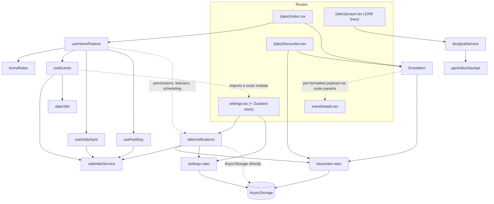
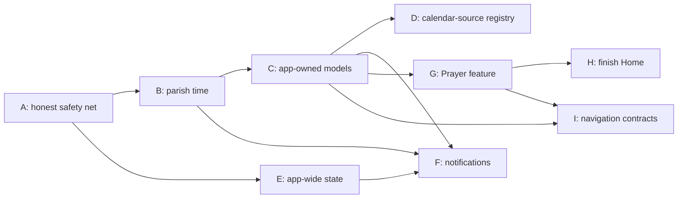
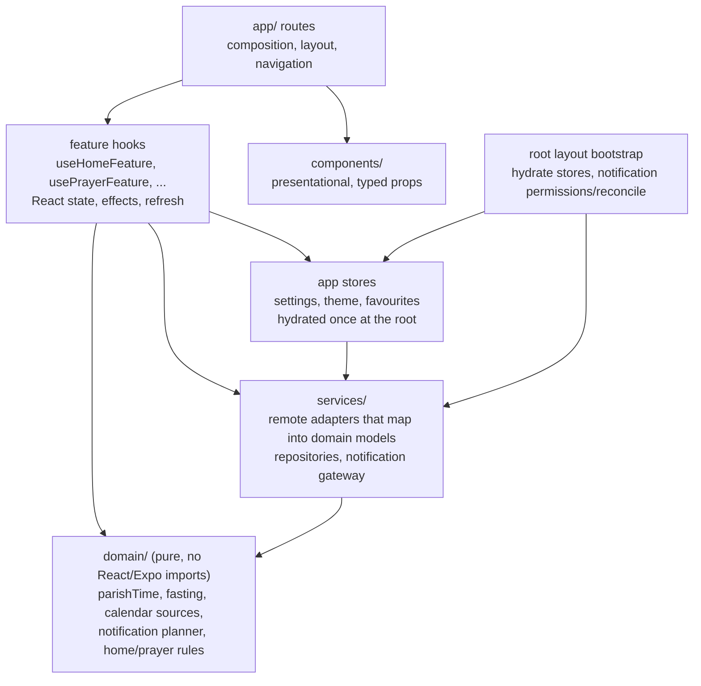

# Next refactoring steps

An architectural reassessment after the first refactoring phase (epics #37, #41, #44, #45 and #49).

**Basis.** This document is based on the repository at commit `0c94b05` (`refactor/43-home-business-rules`, same tree as `master` after PR #74). Every non-test source file was read. The test suite was run with coverage (16 suites, 190 tests, all passing). `tsc --noEmit` and `expo lint` were run, and the open GitHub issues were cross-checked. Line numbers refer to that commit. Where a claim was verified by running something, the evidence says so.

---

## 1. Current Architecture

The app is an Expo Router application with five layers of differing maturity.

| Layer | Where | What lives there |
| --- | --- | --- |
| Routes / screens | [app/](../app) | Root `Stack` in [app/_layout.tsx](../app/_layout.tsx). The tab bar in [<app/(tabs)/_layout.tsx>](<../app/(tabs)/_layout.tsx>) builds its own bottom-tab navigator and imports the five tab screens directly. |
| Feature orchestration | [hooks/useHomeFeature.ts](../hooks/useHomeFeature.ts) | Only the Home tab has one. |
| Data hooks | [hooks/useEvents.tsx](../hooks/useEvents.tsx), [useDailySaint.ts](../hooks/useDailySaint.ts), [useFastDay.ts](../hooks/useFastDay.ts) | Thin React wrappers over `calendarService`. |
| Pure rules | [utils/homeRules.ts](../utils/homeRules.ts), [utils/dateUtils.ts](../utils/dateUtils.ts) | Home labels and section indexing, date grouping, week labels. |
| Remote services | [services/calendar/](../services/calendar/index.ts), [services/liturgical/](../services/liturgical/index.ts) | An interface, one provider implementation, and a module-level singleton for each. Google and Antiochian details stay inside. |
| Local repositories | [services/favourites/](../services/favourites/favouritesRepository.ts), [services/settings/](../services/settings/settingsRepository.ts) | Module functions over AsyncStorage. Storage keys are private. |
| Side effects not yet behind a boundary | [utils/notifications.ts](../utils/notifications.ts), [notifications.tsx](../notifications.tsx), [utils/eventBus.ts](../utils/eventBus.ts), the Zustand store in [app/settings.tsx](../app/settings.tsx) | Notification scheduling and bookkeeping, theme change broadcast, start-of-week state. |
| Presentation helpers | [components/](../components), [styles/](../styles) | Plus Expo-template leftovers ([constants/Colors.ts](../constants/Colors.ts), [hooks/useThemeColor.ts](../hooks/useThemeColor.ts), `ThemedText`/`ThemedView`, `HapticTab`, `TabBarBackground`). |

The actual import graph is below. Dashed edges are dependencies that point the wrong way or bypass a boundary.

Feature by feature, the refactoring has reached very different depths:

| Feature | Orchestration | Business rules | Data access | Tests |
| --- | --- | --- | --- | --- |
| Home | `useHomeFeature` ✅ | `homeRules` ✅ (fast classification still split, see 3.1) | `calendarService` ✅ | Hook, rules and screen tested. |
| Favourites | In screen (small, fine) | Expiry in repository ✅ | Repository ✅ | Screen and repository tested. |
| Settings | In screen | Defaults in repository ✅ | Repository ✅, store in route file ❌ | Screen and repository tested. |
| Prayer | In screen ❌ | In screen ❌ | `liturgicalService` ✅ (Antiochian-shaped types) | Service only. The screen is never loaded by a test. |
| Notifications | Triggered from Home hook and Settings screen | Mixed into scheduling ❌ | Direct AsyncStorage ❌ | None. Mocked everywhere. |
| Event details | In screen | Formatting in `EventItem` ❌ | Route params | None. |

---

## 2. What Has Improved

- **Remote providers are isolated.** No file outside [services/calendar/](../services/calendar/index.ts) knows about Google Calendar. Calendar IDs, URLs and payload shapes are in [googleCalendarConfig.ts](../services/calendar/googleCalendarConfig.ts) and [googleCalendarMapper.ts](../services/calendar/googleCalendarMapper.ts). Likewise, [api/AntiochianApi.ts](../api/AntiochianApi.ts) is imported only by `services/liturgical`. Both services take their dependencies through the constructor (`fetchFn`, `client`), so they are tested without the network.
- **Persistence is almost fully behind repositories.** A search for `AsyncStorage` in non-test code finds only the two repositories and `utils/notifications.ts`. The screen tests assert that screens "do not read or write … storage directly" ([favourites.test.ts](../__tests__/favourites.test.ts), [settings.test.tsx](../__tests__/settings.test.tsx)). Those tests enforce the boundary rather than just exercising the code.
- **Home has a clear three-level shape.** The screen renders and navigates, [useHomeFeature](../hooks/useHomeFeature.ts) owns React state and effects, and [homeRules](../utils/homeRules.ts) is pure and has no React imports. This is the pattern the rest of the app should follow.
- **Date logic is pure and explicit about time zones.** [dateUtils.ts](../utils/dateUtils.ts) now takes `startOfWeek` as a parameter instead of reading the store. It also pins `Australia/Melbourne` and has time-zone-independent tests. (Section 6.4 of [current-architecture.md](current-architecture.md), which says otherwise, is out of date.)
- **Configuration has partly moved out of source.** The Google key comes from `EXPO_PUBLIC_*` environment variables ([constants/consts.tsx:5-17](../constants/consts.tsx)), per #50.
- **The working method is sound.** Characterization tests came before each change, each PR is small and tied to an issue, and CI runs tests, lint and typecheck. Known defects were filed as issues (#59–#64, #69) rather than silently "fixed" mid-refactor.

---

## 3. Remaining Weaknesses

### 3.1 The domain model is thin, and business rules are split across layers by string contracts

- **`EventData` is lossy and mixes concerns** ([types/global.d.ts](../types/global.d.ts)):
  - It carries `data: never[]`, a `SectionList` artefact, inside the domain type.
  - `start` is always an ISO instant ([googleCalendarMapper.ts:36-38](../services/calendar/googleCalendarMapper.ts)), but `end` is the raw provider string, which is date-only for all-day events (`:39`).
  - There is no all-day flag. As a result, `EventItem`'s all-day check `item.start && !item.start.includes("T")` ([EventItem.tsx:62](../components/EventItem.tsx)) can never be true. The "All day" label is unreachable, and all-day events render in Melbourne as a time range such as "10:00 am to 10:00 am". This predates the refactor: the old `useEvents` also called `toISOString()`. The mapper tests now pin it. Issue #61 covers the sorting side but not the model.
- **Fast classification is split between two modules that disagree.** [useFastDay.ts:24-32](../hooks/useFastDay.ts) keeps fasting events whose lower-cased title is in a whitelist, then title-cases them. [homeRules.ts:15-29](../utils/homeRules.ts) maps title-cased strings to labels. The whitelist contains `"nativity fast"`, which becomes `"Nativity Fast"`, but `getMajorFastLabel` only matches `"The Nativity Fast"`. **No calendar title can produce the Nativity Fast label.** Each half passes its own tests ([useFastDay.test.ts](../__tests__/useFastDay.test.ts), [homeRules.test.ts:35](../__tests__/homeRules.test.ts)), because the contract between them is an untyped string.
- **The liturgical "provider-neutral" interface is the Antiochian shape.** [LiturgicalDataService.ts:1-17](../services/liturgical/LiturgicalDataService.ts) re-exports `LiturgicalDay` (which has `[key: string]: any`, [AntiochianApi.ts:21](../api/AntiochianApi.ts)), `ReadingTeasers` with `reading1…reading3` fields, and so on. Three synchronous transform methods sit on the service only to delegate to the client ([AntiochianLiturgicalService.ts:36-46](../services/liturgical/AntiochianLiturgicalService.ts)). The screen still has to know that services are `LiturgicalText`s whose `typeOfService` contains `"PDF"` ([prayer.tsx:185-194](<../app/(tabs)/prayer.tsx>)). This is issue #34, and it is only half done.
- Saints are `string[]`, and fasting days are `string[]` of display titles.

**Why it matters:** features on the backlog need these concepts as data, not as display strings. Examples are fasting notifications (#13), a fasting calendar (#23), event filters (#18), Arabic localisation (#21) and widgets (#9). Today, reusing "is today a fast day?" outside the Home screen means going through a React hook.

### 3.2 There is no single definition of "the parish day"

Each module decides "today" and "this month" differently:

| Module | Convention |
| --- | --- |
| [dateUtils.ts](../utils/dateUtils.ts) | `Australia/Melbourne`, explicitly |
| [GoogleCalendarService.getSaintsForDate](../services/calendar/GoogleCalendarService.ts) (`:87-90`) | Device-local `setHours` |
| [AntiochianApi](../api/AntiochianApi.ts) (`:105`, `:131`) | UTC day from `toISOString()`. [A test pins this](../services/liturgical/AntiochianLiturgicalService.network.test.ts): 8am on the 16th in Melbourne requests the 15th. Before about 10–11am local time, the Prayer tab shows yesterday's readings (#59). |
| [homeRules.filterSectionsByMonth](../utils/homeRules.ts) (`:56-66`) | Device-local `getMonth()` |
| [utils/notifications.ts](../utils/notifications.ts) | Device-local `setHours(8)` / `setHours(9)` |
| [useFastDay](../hooks/useFastDay.ts) | Compares "now" against an `end` that is date-only for all-day events, parsed as UTC midnight |
| [EventItem](../components/EventItem.tsx) | Device-local `toLocale*String([])` |

Issues #59 and #61 each fix one symptom. Without a shared module, every future date bug will be fixed the same way: one call site at a time.

### 3.3 Notifications are the least refactored and most fragile area

[utils/notifications.ts](../utils/notifications.ts) (280 lines) mixes reading settings, fetching remote data (`calendarService`), persistence (`notified-*` and `events-*` keys), Expo scheduling and debug logging. Specific problems:

- **Module-level `useState`** (`:14`). Evaluating the module outside a React render throws. Verified in Node against the installed React 19.2.3: `Cannot read properties of null (reading 'useState')`. In the app it only avoids that if it is first required while some component is rendering, in which case it silently attaches a hook to that component. Either way, `calendarSettings` is never assigned. [app/settings.tsx:88](../app/settings.tsx) declares its *own* local state with the same name and does not import this one. (Issue #70 says the Settings screen sets it; it does not.)
- **`events-*` keys are read (`:224`) but never written anywhere in the repository.** `scheduleCategoryNotifications` can therefore never schedule anything, and the UI that calls it is behind `false &&` ([settings.tsx:290](../app/settings.tsx)). Issue #72 proposes a repository for these keys on the assumption that they are "written elsewhere". They are not.
- **Favourite notifications cannot be deduplicated or cancelled.** They write `notified-${date}` using `Date.toString()` (`:202`) but never read it back, so every call schedules duplicates. `cancelAllFavouriteNotifications` matches the title `"Favourite Event"` (`:209`), but the scheduled titles are `` `${title} in 5 days!` ``, so it cancels nothing. This is latent only because the toggle is hidden ([settings.tsx:266](../app/settings.tsx)).
- `cancelAllSaintNotifications` deletes *every* `notified-*` key (`:141`), including category and favourite markers. Notifications are identified by matching title strings.
- App-lifecycle work runs from a screen hook. [useHomeFeature.ts:75-79](../hooks/useHomeFeature.ts) requests permissions, adds listeners that are never removed, and schedules saint notifications. [notifications.tsx](../notifications.tsx) installs the notification handler as an import side effect.
- **Stored state and the UI disagree.** `loadNotificationToggles` rewrites a user's `"false"` saint flag to `"true"` whenever Settings opens ([settingsRepository.ts:98-115](../services/settings/settingsRepository.ts), #69). The screen shows "off", but Home schedules the notifications on the next launch.

Issues #70–#72 propose wrapping the existing keys in repositories. That would move the problems above behind a new file without fixing them.

### 3.4 App-wide state lives in screens, or in every component instance

- **The start-of-week store is defined in a route file** ([app/settings.tsx:52-67](../app/settings.tsx)), and a data hook imports it ([useEvents.tsx:1](../hooks/useEvents.tsx)). That makes `hooks/` depend on `app/` and on the Settings screen's entire import graph (pickers, `utils/notifications`). [useEvents.test.ts](../__tests__/useEvents.test.ts) has to mock `@/app/settings` as a result.
- **The saved start of week is not applied on cold start.** The store is hydrated only in the Settings screen's effect (`settings.tsx:107-109`). Until the user opens Settings, Home groups by the default `"monday"`. `useEvents` reads `useSettingsStore.getState()` (`:12`) non-reactively. It picks up a change only because Home happens to refetch on focus.
- **Theme** is read from AsyncStorage by *every* `useColorScheme()` instance ([useColorScheme.ts:17](../hooks/useColorScheme.ts)). That covers 14 non-test files, including every `EventItem` in the list. Changes are broadcast over a global `eventBus`. The theme picker itself is hidden (`settings.tsx:172`), so a user who previously saved "dark" cannot change it back.
- **Favourite status** is read per `EventItem` (a full JSON parse of all favourites for each row, [EventItem.tsx:29-38](../components/EventItem.tsx)). No shared state exists, so [useHomeFeature.ts:84-88](../hooks/useHomeFeature.ts) refetches all nine Google calendars on *every* tab focus "to reload … favourite status".

### 3.5 Prayer is where Home was before #42 and #43

[<app/(tabs)/prayer.tsx>](<../app/(tabs)/prayer.tsx>) is 1,009 lines:

- **It has three separate load paths with different semantics.** The initial effect (`:308`), the date picker `handleConfirm` (`:219`) and pull-to-refresh `onRefresh` (`:265`) all fetch and populate state. Only the date-picker path treats "no PDFs" as an error, so the same day shows "Error loading prayers" or "There are no liturgical texts today" depending on how the user got there. Refresh silently resets the chosen date to today. There is no guard against a slow response overwriting a newer date.
- **Business logic sits in the screen.** It groups PDFs by `typeOfService`, strips a `(PDF)` suffix with a regex in two places, and uses a *different* title-case library (`titlecase`) from the rest of the app (`utils/toTitleCase`).
- **The markup is copy-pasted.** Three near-identical reading cards (`:441`, `:507`, `:573`) and three "open PDF" lists, the "Silence Your Phone!" alert appears three times (`:668`, `:774`, `:841`), and the static prayer/service catalogues are inline (`:72-151`).
- **The foreground-refresh logic is a copy** of the one in `useHomeFeature` (a second 300-minute threshold, the same `AppState` handling).
- **Full reading HTML is passed through route params** to `/dailyReadings` (`:455`, `:521`, `:587`). The receiving screen types `type` as `"epistle" | "gospel"` ([dailyReadings.tsx:22](../app/dailyReadings.tsx)), but `"thirdReading"` is also sent.

### 3.6 "Calendar source" is an implicit concept copied in six places

The same nine keys (`youth`, `weekly`, `church`, …) are defined in:

1. [googleCalendarConfig.ts](../services/calendar/googleCalendarConfig.ts), whose comment says the keys "drive colours and notification settings". The provider config file has become the de-facto domain registry.
2. `Colours.event` in [styles/Colours.tsx](../styles/Colours.tsx)
3. `eventColorMap` in [EventItem.tsx:94-104](../components/EventItem.tsx)
4. a second `eventColorMap` in [settings.tsx:142-152](../app/settings.tsx)
5. `DEFAULT_NOTIFICATION_CALENDARS` in [settingsRepository.ts:28-38](../services/settings/settingsRepository.ts)
6. `imageMap` in [eventDetails.tsx:74-84](../app/eventDetails.tsx), which falls back to `imageMap.default`, a key that doesn't exist

On top of that, [constants/consts.tsx:19-53](../constants/consts.tsx) still holds dead copies of every calendar ID and URL. Adding a calendar, or building event filters (#18) or the settings page (#54), means editing all of these consistently.

### 3.7 Navigation contracts are untyped and carry pre-formatted data

- `EventItem` pushes `{ ...item, start: formattedStart, end: formattedEnd }` ([EventItem.tsx:114-117](../components/EventItem.tsx)). [eventDetails.tsx:66-67](../app/eventDetails.tsx) reads the result as `useLocalSearchParams<EventData>()`, so `start` is typed as an ISO string but actually holds something like `"7:00 pm"`. The mapper even documents that fields stay `undefined` "because the details screen checks for null" ([googleCalendarMapper.ts:27-29](../services/calendar/googleCalendarMapper.ts)): the provider mapper is shaped around a screen.
- The tab layout imports from an internal path, `expo-router/build/react-navigation/bottom-tabs` ([<(tabs)/_layout.tsx:7>](<../app/(tabs)/_layout.tsx>)), and bypasses Expo Router's `Tabs` and typed routes (`typedRoutes: true` in [app.json](../app.json)). `RootTabParamList` is declared inside `HomeScreen` with a `"Home"` tab, but the tab is called `"Events"` ([<index.tsx:59-62>](<../app/(tabs)/index.tsx>)).
- [app/discarded/](../app/discarded) lives under `app/`, so Expo Router registers those files as real routes.

### 3.8 Home still has seams between rules and presentation

- ✅ (#90) **The month filter used to trap the user.** The month picker lived in the header of `sectionIndex === 0`, so a month with no events removed the only way to change the filter. The calendar button is now in the top bar, the picker modal sits outside the `SectionList`, and a "Clear month filter" button shows whenever a month is selected.
- Loading and error state is dropped. `useDailySaint` returns `error` and `useEvents` returns `loading`, but `useHomeFeature` uses neither. Only `fastLoading` gates the screen.

### 3.9 There is no error-handling convention

`getParishEvents` logs and skips each failed calendar. `getSaintsForDate` returns `[]` on failure, while `getFastingEvents` throws. The hooks `console.error` and carry on. Only Prayer shows an error to the user. As a result, "offline", "misconfigured" and "no events" all look the same. In particular, a missing `.env` makes `API_KEY` `undefined` ([consts.tsx:5-17](../constants/consts.tsx)): every calendar request fails, and each failure is swallowed.

### 3.10 Testing weaknesses that the test count hides

- **The 92% coverage figure only counts files that some test imports.** No `collectCoverageFrom` is configured. The Prayer, Home and event-details screens, `utils/notifications.ts`, `notifications.tsx`, `useDailySaint`, Help, About, `DonateSection`, `dailyReadings` and `pdfViewer` are not in the report at all. Together that is about 3,160 of roughly 5,800 non-test source lines, including the largest and riskiest files.
- **Every test that touches notifications mocks both notification modules** ([useHomeFeature.test.ts:37-46](../__tests__/useHomeFeature.test.ts), [settings.test.tsx:34](../__tests__/settings.test.tsx)). Neither module is ever evaluated under Jest, which is why the module-level `useState` (3.3) goes unnoticed.
- **Characterization tests pin known defects without saying so.** Examples: the saint flag reset ([settingsRepository.test.ts:126-138](../services/settings/settingsRepository.test.ts), #69), UTC day keying ([network test](../services/liturgical/AntiochianLiturgicalService.network.test.ts), "keys requests by UTC calendar day", #59), and all-day events at UTC midnight ([googleCalendarMapper.test.ts:112](../services/calendar/googleCalendarMapper.test.ts), #61). Pinning behaviour was the right call. Read without the issues, though, these tests look like a specification.
- **Rules that are split across modules are tested only in halves** (the Nativity mismatch in 3.1). Nothing tests "given this fasting calendar entry, Home shows this label".
- **Hook tests take inconsistent seams.** [useEvents.test.ts](../__tests__/useEvents.test.ts) mocks `calendarService`, but [useFastDay.test.ts](../__tests__/useFastDay.test.ts) stubs global `fetch` and runs through the real Google service and mapper. It controls time by module-mocking `getCurrentDate`, a function marked `TODO: Remove` ([dateUtils.ts:195-199](../utils/dateUtils.ts)). The background-refresh branch of `useHomeFeature` (`:54-71`) is uncovered.
- **Typecheck passes in CI but fails locally.** `npx tsc --noEmit` exits 2 locally with `services/calendar/index.ts(10,3): Type 'string | undefined' is not assignable to type 'string'`. CI passes because the git-ignored `expo-env.d.ts` and `.expo/types` are absent there, which changes how `process.env` is typed. So CI does not check what developers see, and the real problem (the key may be undefined) is invisible in CI.

### 3.11 Dead code, duplicates and dependency drift

- **Dead constants:** [consts.tsx](../constants/consts.tsx) has dead calendar IDs and URLs (`:19-53`), `ANTIOCHIAN_API_KEY` (`:59-60`, a committed bearer token) and `DAILY_SAINTS_KEY` (`:89`).
- **Unused and leftover code:**
  - The `@deprecated` helpers in [AntiochianApi.ts:182-202](../api/AntiochianApi.ts) have no callers.
  - `CLIENT_SECRET` is still in source (`:5`).
  - [index.js](../index.js) imports a nonexistent `./App`; the real entry point is `expo-router/entry`.
  - `HapticTab` and `TabBarBackground` are unused.
- **Parallel implementations:** two colour systems (`constants/Colors` and `styles/Colours`), two title-case implementations, and two HTML-entity libraries (`he` and `html-entities`).
- **Dependencies:** no imports found for `react-native-paper`, `react-native-popup-menu`, `react-native-fs`, `expo-file-system`, `@react-native-community/slider`, `expo-web-browser`, `fs` or `i`. `react-test-renderer` is in `dependencies`.
- **Small bugs spotted on the way:**
  - The `switch` in [<help.tsx:46-56>](<../app/(tabs)/help.tsx>) falls through, so every email gets the default message.
  - `openInMaps` URL-encodes the address twice ([eventDetails.tsx:115-116](../app/eventDetails.tsx)).
  - `SplashScreen.preventAutoHideAsync()` and `import "expo-dev-client"` sit at module scope in the Home screen.
- **Stale documentation:** [current-architecture.md](current-architecture.md) is out of date in §4 (the API key), §5 ("one visible Jest snapshot test"), §6.3 ("each hook constructs its own URL") and §6.4. Its links also point at a worktree path (`SPAOC.worktrees/add-readme-file`).

---

## 4. Recommended Next Refactoring Steps

Each step is sized to be one epic of two to five small PRs, in the style used so far.

### Step A: Make the safety net honest

**What:**
- Configure Jest `collectCoverageFrom` for `app/`, `components/`, `hooks/`, `services/`, `utils/` and `api/` (excluding `app/discarded` and tests), so untested files show up at 0%.
- Make the typecheck result the same in CI and locally. Handle a missing calendar key explicitly (a clear configuration error in development) instead of passing `string | undefined`. Also stop the result depending on git-ignored generated files: either generate them in CI or declare the `EXPO_PUBLIC_*` variables in a checked-in `.d.ts`.
- Rename tests that pin known defects so the issue number is visible, e.g. `it("pins #59: keys requests by UTC day", …)`.
- Add an ESLint `no-restricted-imports` rule: nothing outside `app/` imports from `@/app/*`, and `@react-native-async-storage/async-storage` is only imported under `services/`. Scope it with overrides so the current violations are listed; don't block on them.

**Why:** later steps get measurable progress and boundaries that are enforced automatically instead of by review. All of this is cheap.

### Step B: Introduce one "parish time" module

**What:**
- Create a small pure module, e.g. `domain/parishTime.ts`. It owns `APP_TIME_ZONE` and provides `parishDayKey(date)`, `startOfParishDay` / `endOfParishDay`, `isSameParishMonth` and an injectable `now`. The injectable `now` replaces the `getCurrentDate` TODO seam.
- Move `dateUtils`' existing time-zone helpers into it.
- Switch these call sites over: `getSaintsForDate`'s range, the Antiochian day key and day-ID span (fixes #59), `filterSectionsByMonth`, the notification times and the fast-day "today" check.

**Why:** this fixes 3.2 once instead of per issue, and gives every later step a deterministic clock for tests.

### Step C: Give the app its own event, fast and liturgical models (completes #34; absorbs #60–#64)

**What:**
- **Events:** `CalendarEvent` gets `allDay: boolean` and a consistent `start`/`end` representation built with `parishTime`. Drop `data: never[]`; add it at the list/view layer if `SectionList` still needs it. This fixes #61 and makes the `EventItem` all-day label reachable. Skipping malformed events rather than whole calendars (#60) belongs in the same mapper change.
- **Fasting:** create one pure module (e.g. `domain/fasting.ts`) that turns fasting-calendar entries and a day into typed fast kinds. Label and precedence tables live beside it. `useFastDay` becomes a thin hook, and `getMajorFastLabel`/`getMinorFastLabel` move out of `homeRules`. Add an end-to-end rule test from calendar title to label, which would have caught the Nativity mismatch.
- **Liturgical:** `AntiochianLiturgicalService` maps into an app-owned shape along the lines of `{ feastTitle?, readings: { kind, title, teaser, text }[], services: { title, pdfUrl }[] }`. That means Prayer's `organizeData` and the `(PDF)` stripping move into the mapper. The three synchronous helper methods leave the interface, and the Antiochian types stop at `services/liturgical`. #62–#64 are fixes inside that mapper.

**Why:** backlog features (#13, #18, #21, #23) need these concepts as data. This also removes the string contracts between hook and rules.

### Step D: Create a calendar-source registry

**What:**
- Define one list of parish calendar categories: key, display name, colour, detail image and default notification setting.
- `googleCalendarConfig` keeps only the key-to-`calendarId` mapping. `EventItem`, Settings, `eventDetails` and `settingsRepository` defaults all read from the registry.
- Delete the dead copies in `consts.tsx` and add the missing default image.

**Why:** it removes six copies (3.6) and is a prerequisite for event filters (#18) and the settings page (#54). It is small and mechanical once `CalendarEvent.source` is typed in Step C.

### Step E: Move app-wide state out of screens and component instances

**What:**
- **Settings store:** move the Zustand store to `services/settings/` (or a `stores/` folder). Hydrate it once at app start from the repository, in the root layout, for start of week *and* theme. `useEvents` subscribes with a selector instead of `getState()`. `useColorScheme` reads the store, and `eventBus` goes away. Fix #69 here: it is a one-line repository change, and this is where toggles get their single source of truth.
- **Favourites:** create a small favourites store or hook, loaded once, exposing `isFavourite(event)` and `toggle(event)`. `EventItem` reads and writes through it. `useHomeFeature` no longer refetches every Google calendar on focus.

**Why:**
- It fixes the cold-start start-of-week bug and removes the `hooks` → `app` dependency.
- It removes the per-row storage reads and a network round-trip on every tab switch.
- Step F needs a settings source it can read outside React; this provides it.

Zustand is already a dependency, so this adds no new library.

### Step F: Rebuild notifications as a feature module (re-scopes #70, #71, #72; enables #13 and #16)

**What:**
1. **Decide the product scope first.** Saint notifications are live. Favourite and per-calendar notifications are hidden and non-functional. Recommendation: delete category scheduling, the `events-*` path and the module-level `useState` now (resolves #70; close #72 as not needed), and rebuild favourites and categories later on the new structure if they are wanted.
2. **Split the module into three parts:**
   - A **pure planner**: given saints, favourites, settings and `now`, return the notifications that *should* exist, each with a stable identifier and a `kind`.
   - A thin **Expo gateway**: schedule with that identifier, list the scheduled notifications, and cancel by kind using `content.data`.
   - A **reconcile step** that diffs "should exist" against "is scheduled".

   Expo can list scheduled notifications, so the `notified-*` markers (#71) may become unnecessary. If some bookkeeping remains, fix its key semantics before wrapping it in a repository.
3. **Move app-lifecycle work out of the Home hook.** Permission requests, listeners (with cleanup) and the initial reconcile move from `useHomeFeature` into an app bootstrap in the root layout. The notification handler setup stops being an import side effect.

**Why:** 3.3 is a set of correctness bugs, not only a boundary problem. With a pure planner, notification behaviour becomes testable without mocking whole modules, and fasting notifications (#13) and liturgy reminders (#16) become a few lines of planner logic.

### Step G: Give Prayer a feature hook and presentational components (mirrors #42 and #43)

**What:**
- **`usePrayerFeature`:** owns the selected date and a single `load(date)` path, with a stale-response guard and one definition of "empty" versus "error". Refresh keeps the selected date.
- **`useForegroundRefresh(thresholdMinutes, onRefresh)`:** extracted from `useHomeFeature` and reused by Prayer.
- **Prayer catalogue:** move the static prayers and services (currently titles and icons in the screen, URLs in `consts.tsx`) into one data module.
- **Components:** `ReadingCard` and `PdfLinkList` render from the Step C model, and one `openServicePdf` owns the silence alert.

**Why:** Prayer is the largest file and has no screen-level tests. This step brings it to Home's shape. Doing it after Step C means the hook is written against the final data model instead of the Antiochian one.

### Step H: Finish Home's presentation seam

**What:**
- ✅ (#89) Render the top image and the saint/fast block as `ListHeaderComponent` and the bottom image as `ListFooterComponent`. `buildHomeSections` and its sentinel strings are gone, and `ListEmptyComponent` works.
- ✅ (#90) Move the month picker into the top bar and add "clear filter". This removes the trap in 3.8 and is probably related to #26.
- ✅ (#89) Hoist `SectionHeader` out of the render function.
- Surface events, saint and fast loading and error states from `useHomeFeature`, following the convention agreed in Step G.

**Why:** these are small changes that finish the Home epic and remove a user-facing dead end.

### Step I: Type the navigation contracts

**What:**
- Pass event details as a typed payload that holds the raw model (or an id plus a lookup). Format the dates in `eventDetails`, not in `EventItem`.
- Correct the `dailyReadings` param type, or pass a reading reference instead of full HTML.
- Replace the hand-built tab navigator with Expo Router's `Tabs`, which removes the `expo-router/build/...` internal import and brings the tabs under typed routes.
- Move `app/discarded/` out of `app/`.

**Why:** 3.7. Also, route params are currently the only contract between screens, and nothing checks them.

### Step J: Continuous cleanup (fold into the steps above rather than doing as an epic)

**What:**
- Delete dead constants, the deprecated Antiochian exports, `index.js`, the unused template components and the unused dependencies.
- Settle on one title-case helper and one HTML-entity decoder.
- Fix the Help `switch` fall-through and the double encoding in `openInMaps`.
- Move the Antiochian client credentials to configuration (the same approach as #50).
- Update [current-architecture.md](current-architecture.md) at the end of each step. It is already stale in the places listed in 3.11.

---

## 5. Suggested Order

The order follows dependencies between the steps, not severity.

1. **Now: Step A, plus three one-line or deletion fixes.** Delete the module-level `useState` and the dead `events-*` path (part of F.1, but it is a latent crash that costs nothing to remove). Fix the Nativity whitelist and the #69 flag rewrite. A goes first because every later step should show coverage moving on files that are currently invisible, and the lint rule stops new violations while the old ones are paid down.
2. **Step B before Step C.** C's mappers need the parish-day definition to model all-day events and liturgical days correctly. In the other order, #59 and #61 get fixed once with ad-hoc date code and then again when that code is replaced.
3. **Step C before D, G and I.** The registry types `source`, the Prayer hook consumes the liturgical model, and route params carry the event model. Each of these would otherwise be written twice.
4. **Step E before Step F, and E can start in parallel with B and C.** E touches settings, theme and favourites, not the models. F needs settings and favourites readable outside React. Starting F without E would recreate the "read settings from somewhere" problem behind #70.
5. **Step F after B, C and E.** The planner needs parish time for 8am and 9am triggers, the fast model for #13, and the stores for its inputs. It is also the step with the most user-visible risk, so it should come once the foundations are tested.
6. **Step G after C, then Step H.** H reuses G's `useForegroundRefresh` and G's loading/error convention. Otherwise Home and Prayer would settle on two conventions again.
7. **Step I last.** Params change shape once, after both the models (C) and Prayer's navigation (G) are final.

Where the open issues fit: #59 → B; #34, #60, #61, #62, #63, #64 → C; #69 → now (or E); #70 → now (deletion); #71, #72 → F (re-scoped or closed); #26 → probably H; #18, #54 → unblocked by D; #13, #16 → unblocked by F.

---

## 6. Things Not Worth Refactoring Yet

- **About, Help, `DonateSection`, `dailyReadings` and `pdfViewer`.** They are static or presentational with no business rules. Extracting hooks from them adds files without adding seams. Fix the two small bugs (the Help `switch`, `openInMaps`) and leave them alone. Keep `pdfViewer`'s `USE_WEBVIEW` flag until #28 decides the PDF strategy.
- **Styling.** Per-render `getStyles()`, inline style objects and the `colorScheme === "dark" ? Colours.dark : Colours.light` line repeated in ten files are untidy but harmless. When Step E rewrites `useColorScheme`, have it return the palette too, which removes the repetition for free. Don't introduce a theming library or design system.
- **Repository style.** Plain module functions over AsyncStorage are the right weight for two small stores. A generic `Repository<T>` or storage adapter would abstract over two modules with different shapes, and the AsyncStorage Jest mock already makes them testable.
- **Provider interfaces and dependency injection.** Keep `CalendarDataService` and `LiturgicalDataService` and their constructor-injected dependencies. Don't add a DI container or registry: module singletons plus constructor injection in tests is enough, and no second provider is planned.
- **`groupEventsByDay` and `getStartOfWeek`.** They are intricate but well tested with explicit time zones. Only their time-zone constants should move into Step B's module.
- **Antiochian client internals.** The day-ID anchor arithmetic is odd but covered by 47 tests. Fix the filed bugs inside the mapper and client, but don't restructure the client.
- **A big-bang folder restructure (#27).** A mass move to `features/…` would churn every import, break blame and conflict with open work, for little architectural gain. Move modules when a step touches them (e.g. notifications into `services/notifications/` during F). Treat #27 as "done incrementally".
- **Data-fetching libraries (React Query, SWR).** Three remote reads and one shared refresh hook don't justify one. Revisit only if offline caching or cross-screen cache sharing becomes a feature.
- **Wrapping haptics or navigation.** Direct `Haptics.impactAsync` and `router.push` calls are idiomatic and trivially mockable. A navigation service would only add indirection. Typing the params (Step I) is the part that matters.
- **Merging the three Home data hooks.** `useEvents`, `useDailySaint` and `useFastDay` are small and single-purpose. After Step C they get thinner, not bigger. Merge them only if a second screen needs the same bundle.

---

## 7. Architectural Direction

After the next phase the app should have the same shape everywhere that Home has now, with the missing layers filled in.

Rules the codebase should be able to state (and, where possible, lint for):

1. **Routes compose; they do not decide.** A route file imports feature hooks, components and navigation. Nothing imports *from* `app/`.
2. **Domain modules are pure.** They have no React, React Native, Expo or AsyncStorage imports, and they receive "now" explicitly. There is one definition of the parish day and one registry of calendar sources.
3. **Provider types stop at `services/*`.** Screens and hooks see `CalendarEvent`, `LiturgicalDay` (app-owned), fast kinds and saints. They never see Google or Antiochian shapes.
4. **Only repositories and gateways touch platform storage and scheduling.** That means AsyncStorage and `expo-notifications`.
5. **App-wide state is hydrated once.** Settings, theme and favourites are read from stores, not from storage on every mount and not from a store defined in a screen.
6. **Features share conventions.** Loading, empty and error states are handled the same way, foreground refresh is shared, and every feature has tests at the rules level and the hook level.

These signals, measurable from the repository, show whether the direction is holding:

| Signal | Now | Target |
| --- | --- | --- |
| Non-repository files importing AsyncStorage | 1 (`utils/notifications.ts`) | 0 |
| Non-route files importing from `@/app/*` | 1 (`hooks/useEvents.tsx`) | 0 |
| Places defining the calendar-source list | 6 | 1 |
| Definitions of "today" | ~5 conventions | 1 module |
| Source files absent from the coverage report | ~3,160 lines | Reported, and trending down |
| `tsc --noEmit` agreement between CI and local | Differs | Same result |
| Largest screen | 1,009 lines (Prayer) | Screen is layout only; logic lives in a hook and rules |
